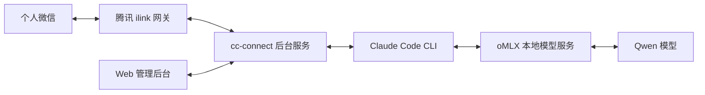

# 本地模型 + Claude Code + cc-connect：微信接入与排障方案

归档与最后核查：2026-11-06，时间基准为北京时间。适用范围：macOS arm64、oMLX 本地模型服务、Claude Code CLI、cc-connect 的个人微信 Weixin / ilink 通道。本文记录一次真实部署的配置、排障与验证，不包含登录凭证、私人目录、微信身份或完整聊天记录。

## 摘要

本方案让微信成为本地编码助手的入口：cc-connect 接收消息，调用 Claude Code，Claude Code 通过 Anthropic 兼容接口访问 oMLX 中的 Qwen 模型，再由 cc-connect 把回答发回微信。

本次最终确认的参数为：

| 项目 | 已确认值 | 含义及验证边界 |
| --- | --- | --- |
| 本地模型 | `Qwen3.8-Flash-Next-oQ4e-mtp` | 实际运行的模型名称，不是 Anthropic 托管的 Claude 模型 |
| 输入／上下文配置上限 | 262,144 tokens | 模型服务与 Claude 环境配置均为此值；没有做满窗口压力测试 |
| 单次输出上限 | 32,768 tokens | 已在发往真实本地服务的请求中检查 `max_tokens = 32768` |
| 思考档位 | `xhigh` | 请求携带 `output_config.effort = "xhigh"`；本地模型模板默认也是 xhigh |
| 微信显示 | 安静模式 | 隐藏思考、工具调用、工具执行状态及回复尾栏 |
| 入站消息频率限制 | 已关闭，`max_messages = 0` | 后台窗口时长仍显示 60 秒，但不再按它拦截消息 |
| 普通微信文字回复预算 | 不计入主动推送预算 | 已升级到含修复版本；主动推送仍保留每 60 秒最多 60 条的本地配置 |
| 日志级别 | `info` | 已从排障用 debug 调回，重启后没有继续输出 DEBUG 日志 |

两个“收到消息但没回复”的故障先后出现，原因不同：

- 第一次：模型已经完成回答，回复尾栏触发用量查询后没有继续完成发送。关闭尾栏后恢复；与上游已报告的 `/usage` 死锁高度吻合，但本机没有抓取阻塞时的 goroutine 堆栈。
- 第二次：模型完成回答，但 cc-connect v1.5.0 的本地发送预算耗尽，在请求微信之前就拦下了回答。上游后续修复已区分普通回复和主动推送预算。

本次先在 **v1.5.0** 上以配置恢复使用，随后经用户确认，升级到官方 **v1.5.1-beta.4**。该版本同时包含用量查询死锁修复和普通回复预算修复，已完成发布包哈希校验、相关回归测试及一次真实微信短对话的发送验证；长期稳定性仍需观察。[用量问题][usage-issue] · [用量修复][usage-pr] · [微信预算修复][budget-fix] · [版本发布记录][beta4]

## 1. 链路和职责



| 层次 | 负责什么 | 本次入口或配置 |
| --- | --- | --- |
| 微信通道 | 收发消息、登录状态、会话回复上下文 | `type = "weixin"`，网关 `https://ilinkai.weixin.qq.com` |
| cc-connect | 调用 Agent、会话、消息展示、发送预算、Web 管理 | `~/.cc-connect/config.toml` |
| Claude Code | 编码工具、权限交互、模型请求参数 | 由 cc-connect 启动的 `claude` 子进程 |
| oMLX | 加载模型、执行推理、应用模型模板与采样配置 | `http://127.0.0.1:8000` |
| Web 管理 | 配置与查看 cc-connect | `http://localhost:9820/`；由同一个后台服务托管 |

本次属于真实本地推理和真实微信联调；环回地址不表示 mock。安装参考中的企业微信 `wecom` 和个人微信 `weixin` 是不同接入方式，不应混用凭证和教程。[安装说明][install] · [个人微信说明][weixin-doc]

## 2. 版本和证据基线

| 组件 | 本次核查版本 | 证据 |
| --- | --- | --- |
| cc-connect 初始故障版本 | `v1.5.0`，提交 `17c61062c2f9ce9bcdd45a2082e491f9743a2770` | 升级前 `--version` 与该版本源码 |
| cc-connect 当前运行版本 | `v1.5.1-beta.4`，提交 `a35b769c3f06dedd63cfc55ee6ccbd1f45c95549` | 官方发布包、升级后 `--version`、管理 API 与 Web 概览 |
| Claude Code | `2.1.318` | 本机 `claude --version`、`claude --help`、真实请求 |
| oMLX | 应用 `0.7.3`，构建 `3574` | 本机应用元数据、随应用安装的 Python 源码 |
| 本地模型模板 | Qwen 模板支持 `xhigh`、`medium`、`low`，默认 `xhigh` | 实际模型的 `chat_template.jinja` 与 `tokenizer_config.json` |
| 上游修复版本 | `v1.5.1-beta.4`，发布于 2026-10-26 | GitHub 发布记录；本机已安装并做有限回归 |

本地应用源码和模型模板没有对应的已核实上游提交，因此不把今天的 oMLX `main` 当成已安装代码。为后续复核保留以下内容指纹：

| 文件（产品内相对路径） | SHA-256 |
| --- | --- |
| oMLX `omlx/server.py` | `e5ef48cdadc46167281eb861d9fe2fc08fc7af89dee6379fb2d46018a7c6400d` |
| oMLX `omlx/api/anthropic_models.py` | `17f084152c88425d07e0fc49ecddc6a2f35d2c58acf931fb5cea670e43188f02` |
| 模型 `chat_template.jinja` | `c3cf9e34abf4f9e36c2d72165aa9c132d3e2a725b6c2586aaa3a8af9d7a81041` |

## 3. 安装和初次接入

### 3.1 准备本地模型服务和 CLI

1. 先在 oMLX 中加载目标模型，确认本地接口可以返回结果。
   - 本次服务地址为 `http://127.0.0.1:8000`。
   - 模型名必须从已加载模型或真实配置中读取，不能按名称习惯猜测。
   - 本次接手时 oMLX 与模型已经安装；本文没有验证一套从零安装 oMLX 的过程。
2. 安装并检查 CLI。

   ```bash
   npm install -g cc-connect
   npm install -g @anthropic-ai/claude-code
   cc-connect --version
   claude --version
   ```

   npm 是官方列出的安装方式；本次接手时两个 CLI 已存在，上述安装命令没有重新执行。安装后记录实际版本，再核对本文的旧版问题是否仍适用。[安装说明][install]

### 3.2 配置 Claude Code 使用本地服务

以下是扫码完成后的**目标配置结构**。尖括号内容均为占位值，需要用真实项目目录、密钥和扫码结果替换；不要把它原样用于启动。

```toml
language = "zh"

[log]
level = "info" # 定位故障时临时切换为 debug。

[rate_limit]
# 关闭按会话统计的入站频率限制；窗口不再用于拦截。
max_messages = 0
window_secs = 60

[display]
# 隐藏工具过程和尾栏，集中显示回答正文。
mode = "quiet"
thinking_messages = false
tool_messages = false
show_context_indicator = false
reply_footer = false

[[projects]]
name = "local-assistant"

[projects.agent]
type = "claudecode"

[projects.agent.options]
work_dir = "<项目绝对路径>"
mode = "default"
provider = "omlx-local"

[[projects.agent.providers]]
name = "omlx-local"
api_key = "<本地模型服务密钥>"
base_url = "http://127.0.0.1:8000"
model = "Qwen3.8-Flash-Next-oQ4e-mtp"

[projects.agent.providers.env]
# 上下文声明、单次输出上限与思考档位。
CLAUDE_CODE_MAX_CONTEXT_TOKENS = "262144"
CLAUDE_CODE_MAX_OUTPUT_TOKENS = "32768"
CLAUDE_CODE_EFFORT_LEVEL = "xhigh"

# 将各模型档位和子 Agent 路由到同一个已加载的本地模型。
ANTHROPIC_DEFAULT_OPUS_MODEL = "Qwen3.8-Flash-Next-oQ4e-mtp"
ANTHROPIC_DEFAULT_SONNET_MODEL = "Qwen3.8-Flash-Next-oQ4e-mtp"
ANTHROPIC_DEFAULT_HAIKU_MODEL = "Qwen3.8-Flash-Next-oQ4e-mtp"
CLAUDE_CODE_SUBAGENT_MODEL = "Qwen3.8-Flash-Next-oQ4e-mtp"
CLAUDE_CODE_DISABLE_NONESSENTIAL_TRAFFIC = "1"
CLAUDE_CODE_ATTRIBUTION_HEADER = "0"

[[projects.platforms]]
type = "weixin"

[projects.platforms.options]
token = "<通过微信扫码写入>"
base_url = "https://ilinkai.weixin.qq.com"
account_id = "<通过微信扫码写入>"

# 当前部署选择的主动推送预算；beta.4 普通文字回复不计入。
burst_limit = 60
burst_window_secs = 60
```

`mode = "default"` 保留 Claude Code 的权限流程；隐藏工具通知不会取消权限确认。v1.5.0 的本地 provider 适配器会设置 `ANTHROPIC_BASE_URL`、Bearer 认证及模型变量，并在自定义服务地址场景清空继承的 `ANTHROPIC_API_KEY`，避免把认证路线混在一起。一般不需要重复在全局 shell 中配置这些路由。[适配器源码][claude-adapter]

### 3.3 微信扫码与后台运行

在配置中准备项目后执行：

```bash
cc-connect weixin setup --project local-assistant
```

按终端二维码在手机微信确认登录。该命令会写入微信凭证；`--project` 必须匹配自己的项目名。服务启动后先从微信发送一条消息，让通道获得并缓存回复所需的 `context_token`。[个人微信说明][weixin-doc]

前台运行便于初次查看错误；确认配置正确后再安装后台服务：

```bash
cc-connect --config ~/.cc-connect/config.toml
```

```bash
cc-connect daemon install --config ~/.cc-connect/config.toml
cc-connect daemon status
```

这两组命令表示前台与后台两种运行阶段，不应同时保留两个实例。已有后台服务时，修改启动相关配置后使用：

```bash
cc-connect daemon restart
```

macOS 本次由 launchd 管理。`daemon status` 显示 Running 只证明进程存在；还要等日志出现 `weixin: ilink ready-for-poll` 和 `platform ready`。本次重启后微信就绪约需 18 秒，这只是一次环境观测，不能作为固定等待时长。

若从 Claude Code 自身会话中启动 cc-connect，官方提示需处理继承的 `CLAUDECODE`，避免子进程被判定为嵌套运行。可在单独终端启动；不要把该故障与模型服务不可用混为一谈。[安装说明][install]

## 4. 输入、输出和 xhigh 如何真正生效

### 4.1 各层配置的作用

| 配置位置 | 字段 | 本次值 | 含义 |
| --- | --- | --- | --- |
| oMLX `~/.omlx/settings.json` | `sampling.max_context_window` | `262144` | 全局上下文默认值 |
| oMLX `~/.omlx/model_settings.json` 的目标模型 | `max_context_window` | `262144` | 该模型的上下文覆盖值 |
| oMLX `~/.omlx/settings.json` | `sampling.max_tokens` | `32768` | 请求未指定时的输出默认值 |
| cc-connect provider 的 `env` | `CLAUDE_CODE_MAX_CONTEXT_TOKENS` | `"262144"` | 传入 Claude Code 的上下文声明 |
| 同上 | `CLAUDE_CODE_MAX_OUTPUT_TOKENS` | `"32768"` | 让 Claude Code 明确发送输出上限 |
| 同上 | `CLAUDE_CODE_EFFORT_LEVEL` | `"xhigh"` | 让 Claude Code 明确发送思考档位 |

oMLX 已读代码的 `get_sampling_params` 优先使用请求的 `max_tokens`，其次才使用模型配置和全局默认。因此只看到 oMLX 的 32768，不能推断 Claude Code 每次都按 32768 请求。Claude Code 官方说明，对无法识别的模型 ID，其默认输出值可能是 32000；本次用环境变量消除了这个差异。[Claude Code 环境变量][claude-env]

上下文还包含系统提示、历史消息、工具定义和工具结果，不能把 262144 理解为任意一条用户消息的可用正文长度。输出上限也会影响 Claude Code 为生成和自动压缩保留的空间。本次没有验证满 262144 输入、再生成满 32768 的组合能力，也没有实际跑满输出上限。

原部署还存在 `CLAUDE_CODE_AUTO_COMPACT_WINDOW = "262144"`。本次没有验证这个变量的压缩触发行为，最小模板不把它当作必要条件；归档结论不包含“已验证自动压缩正常”。

### 4.2 旧枚举直接填写 xhigh 会丢失

该版本 `agent/claudecode/claudecode.go` 中的 `normalizeEffort` 只保留 `low`、`medium`、`high`、`max`。直接在 Agent options 中写 `reasoning_effort = "xhigh"`，会落入默认分支并变为空字符串。[适配器源码][claude-adapter]

本机 Claude Code 2.1.318 的 `--help` 已列出 xhigh，也支持 `CLAUDE_CODE_EFFORT_LEVEL`。因此本次把它写到 **provider 的环境变量**中，绕开 cc-connect 的旧枚举；这不需要更换模型或擅自用 `max` 替代 xhigh。[Claude Code 环境变量][claude-env]

升级后复核 beta.4 的 `normalizeEffort`，仍未包含 xhigh，因此继续保留环境变量配置。beta.4 新增的 `context_window_tokens` 用于上下文占比统计，不代表扩展模型本身的容量；这次没有新增该统计覆盖项。[升级版本适配器][beta-claude]

还有一层必须区分：

- Claude Code 发送的是 Anthropic 请求里的 `output_config.effort`。
- 当前已安装 oMLX 的 `omlx/api/anthropic_models.py` 中，`MessagesRequest` 没有声明 `output_config`；不能仅凭请求里有该字段，就声称 oMLX 已把它转换为模型模板参数。
- 已核对的本地 Qwen 模板在未指定 `reasoning_effort`、且思考未关闭时，默认使用 xhigh。本次实际请求为 `thinking.type = "adaptive"`，已读 oMLX 的 `_prepare_anthropic_prompt` 会将其转为 `enable_thinking = true`。

因此，本次模型端 xhigh 的依据是**实际模板默认值与启用思考的转换链路**，请求中的 effort 字段是额外的参数核对。后续换模型、修改模板默认值或更换 oMLX 版本时，需要重新查证，不能认为所有兼容接口都会消费相同字段。

### 4.3 本次真实请求验证

用一次临时环回转发记录参数，转发到真实 oMLX 服务；不是 mock 返回，也没有向微信额外发送测试通知。测试提示词只要求返回一个短确认，结果正常：

```json
{
  "model": "Qwen3.8-Flash-Next-oQ4e-mtp",
  "max_tokens": 32768,
  "thinking": {"type": "adaptive"},
  "output_config": {"effort": "xhigh"}
}
```

以上为真实请求中与参数有关的字段节选。随后将对应环境变量写入配置、重启 cc-connect，管理 API 返回 HTTP 200，微信通道恢复就绪。这证明参数能够被接收并完成短请求，不代表 xhigh 在所有任务上都比其他档位更好。

## 5. 微信没有回复：按阶段定位

先识别当前进程、配置文件与环境，再按日志顺序定位。不要只凭“进程还在”或某个警告就判定模型卡死。

```text
message received
       |
       v
processing message / session spawned
       |
       v
claudeSession: event type=result
       |
       v
turn complete
       |
       v
平台发送返回成功
       |
       v
用户在微信实际收到
```

| 最后已确认的阶段 | 优先检查 | 本次经验 |
| --- | --- | --- |
| 没有 `message received` | 微信登录、轮询就绪、允许列表、当前配置和日志文件 | 先确认通道，不急于更换模型 |
| 收到消息，没有模型结果 | Claude 子进程、权限请求、模型服务和超时 | 需要确认卡在 Agent 还是推理服务 |
| 已有 `type=result`，没有 `turn complete` | 事件处理、回复尾栏及用量查询 | 第一次故障落在这段区间 |
| 有 `turn complete`，随后 `platform send failed` | 具体发送错误、本地预算、微信网关响应 | 第二次故障为本地预算耗尽 |
| 发送调用返回成功 | 用户实际是否收到 | API 返回成功与用户确认要分开记录 |

本次 `unrecognized_model` 警告曾出现在子进程结束日志里，但同一模型已成功生成回答。该警告不能单独证明模型不可用；排障应结合实际请求和终止位置。

### 5.1 用量查询卡死与回复尾栏

观察到：模型在约两秒内完成结果，cc-connect 记录了回答，后续没有完成发送；关闭尾栏后，微信联调约 3.4 秒完成，用户确认收到。

```toml
[display]
reply_footer = false
show_context_indicator = false
```

关键是 `reply_footer = false` 关闭整个尾栏。只隐藏上下文行不等价于关闭所有尾栏查询。[引擎源码][engine]

上游 [Issue #2015][usage-issue] 报告：`runClaudeUsageProbe` 的读取协程只向 `readDone` 发送一次，主循环可能先接收它，随后清理逻辑再次等待同一通道，从而永久阻塞。即使用量查询设置了 context 超时，清理阶段的重复接收仍可能无法返回。修复 [PR #2081][usage-pr] 改为等待读取协程退出时关闭的 `readerExited` 通道，并增加了回归测试。

本次回复尾栏可以走到同一用量查询函数，与该故障高度吻合；没有对本机阻塞实例抓栈，因此保留“高度吻合”的判断，不宣称已逐帧证明同一个死锁。归档时 issue 仍为 Open，但 PR 已合并；issue 状态与修复是否进入版本必须分开核对。[旧版用量实现][usage-source]

### 5.2 本地发送预算耗尽

第二次故障的真实日志包含：

```text
turn complete
platform send failed
weixin: send budget exhausted (4 messages in the last 24h0m0s)
```

本次图片分析回答和后续文字回答都已生成，但被本地 `checkSendQuota` 拦下。已读 v1.5.0 源码的默认值为 `burst_limit = 4`、`burst_window_secs = 86400`，`Reply` 和 `Send` 都进入相同的预算检查。[旧版微信源码][weixin-source]

临时调整记录：

1. 将窗口调整为每分钟 4 条，备份并重启后，后续回答发送调用成功。
2. 用户明确选择更宽松的每分钟 60 条，再备份、写入 `burst_limit = 60`、`burst_window_secs = 60` 并重启。
3. 没有进行一分钟发送 60 条的压力测试；该值是配置上限，不是已验证的持续吞吐能力。

两个容易误用的结论：

- 错误里关于微信“5–6 条”的说明来自旧适配器的保护策略，不能当成微信官方对所有普通对话的统一额度。
- v1.5.0 的构造函数会把非正的 `burst_limit` 恢复为默认值。尽管部分注释写着“0 关闭”，在该版本通过配置填写 0 并不能可靠关闭这层检查；应以读取的实现为准。[旧版微信源码][weixin-source]

后续核实到，上游 [Issue #1937][budget-issue] 已关闭。修复提交 `9e105e9e9fb137a1b321309a721035dc42ff31b5` 说明：引擎发送正常回答使用 `Platform.Send`，导致普通回复被计入主动推送预算。修复根据入站消息的回复上下文识别普通回复，定时任务等重建上下文的主动发送仍计入推送预算。[修复提交与测试][budget-fix]

因此旧版提高本地额度属于临时措施。升级到包含修复的版本后，应重新评估主动推送的预算，不把每分钟 60 条不加区分地当作新版本默认推荐。微信服务端实际返回的限流错误也需要单独处理。

本次随后实际升级到 beta.4，普通文字回复已走不计推送预算的路径；原有 60／60 配置继续用于主动推送。该预算不能靠填写 0 真正关闭的问题在 beta.4 构造代码中仍存在；这次没有用“极大数值”伪装禁用，也没有修改官方二进制代码。[升级版本微信源码][beta-weixin]

## 6. Web 打不开与免手填令牌登录

### 6.1 `cc-connect web` 不会启动服务

`cmd/cc-connect/web.go` 中的 `runWeb` 负责启用配置并打开浏览器。若此前未启用，它会提示重启；真正监听 9820 端口的是后台 cc-connect 进程。[Web 命令源码][web-source]

本次配置已经存在 `management.enabled = true`、`management.port = 9820`，但运行进程没有加载它。访问 `http://127.0.0.1:9820/` 连接失败，监听列表也没有该端口。重启后首页和认证后的 `/api/v1/status` 均返回 HTTP 200。

可按以下顺序检查：

```bash
cc-connect daemon status
curl --max-time 5 -sS -o /dev/null -w '%{http_code}\n' http://127.0.0.1:9820/
cc-connect daemon logs -n 50
```

若刚启用管理后台，执行：

```bash
cc-connect daemon restart
cc-connect web
```

通过浏览器确认进入管理概览页，才算完成前端验收。仅看到命令打印 `Opening` 不能证明操作系统成功打开浏览器；本次默认 URL 打开器曾返回应用关联错误，最后用应用内浏览器验证并打开登录入口。

### 6.2 登录页需要哪一种令牌

| 凭证 | 用途 | 登录页是否使用 |
| --- | --- | --- |
| `[management].token` | cc-connect Web 管理认证 | 是 |
| `[bridge].token` | Bridge 连接认证 | 否 |
| 微信 `token` | ilink 机器人认证 | 否 |
| provider `api_key` | 本地模型服务认证 | 否 |

`cc-connect web` 会构造 `http://localhost:9820/login?token=...` 自动登录入口。前端成功登录后将管理令牌保存在浏览器 `localStorage` 的 `cc_token` 中，通常不必反复填写；清理站点数据、更换浏览器或变更 origin 后需重新登录。[Web 命令源码][web-source] · [登录页面源码][login-source] · [认证状态源码][auth-source]

`localhost` 和 `127.0.0.1` 是不同浏览器 origin；需要长期保留登录时固定使用同一个入口。不要在公开文档、截图或日志中发布带 token 的完整自动登录 URL。本文只记录协议形式，未保存真实令牌。

## 7. 微信只看正文，隐藏 Bash 与状态 OK

```toml
[display]
mode = "quiet"
thinking_messages = false
tool_messages = false
show_context_indicator = false
reply_footer = false
```

| 字段 | 作用 |
| --- | --- |
| `tool_messages = false` | 隐藏工具调用及执行结果，包括 Bash、状态和退出码等工具通知 |
| `thinking_messages = false` | 不向微信推送思考过程 |
| `mode = "quiet"` | 将工具边界间积累的正文集中展示，减少过程消息 |
| `reply_footer = false` | 关闭整个回复尾栏，同时避开旧版用量查询路径 |
| `show_context_indicator = false` | 隐藏上下文提示；是补充显示设置 |

已读引擎的 `EventToolUse` 和 `EventToolResult` 都检查 `ToolMessages`；这是展示开关，工具执行能力和需要用户确认的权限流程继续存在。模型主动在正式正文中写出的状态文字，也不属于工具通知过滤。[引擎源码][engine]

本次通过本地管理接口 `POST /api/v1/reload` 重新加载显示配置，HTTP 200 返回已更新项目；`GET /api/v1/settings` 回读 `tool_messages = false`、`thinking_messages = false`。这次显示调整没有重启服务，也没有在设置完成后再专门触发一轮 Bash 微信端回归。[管理接口源码][management-source]

## 8. 入站窗口时间、日志级别与升级验证

### 8.1 “窗口内消息数”限制哪一层

后台的 `rate_limit_max_messages`、`rate_limit_window_secs` 对应配置中的：

```toml
[rate_limit]
max_messages = 0
window_secs = 60
```

初始默认值为每个会话在连续 60 秒内最多接受 20 条消息。`RateLimiter.Allow` 按当前时间向前检查滑动窗口，不是到整分钟统一清零。现在设为 0 后，入站检查不再拦截，窗口字段继续显示 60 并不表示限制仍开启。[升级版本限流实现][beta-ratelimit]

需要区分三层：

| 限制 | 控制什么 | 本次最终状态 |
| --- | --- | --- |
| `rate_limit.max_messages` / `window_secs` | 用户进入一个会话的消息频率 | 关闭，`max_messages = 0` |
| `outgoing_rate_limit.max_per_second` | 引擎给平台发送消息的节流 | 没有配置启用；默认关闭 |
| 微信 `burst_limit` / `burst_window_secs` | 平台适配器中的主动推送预算 | 保留 60／60；beta.4 普通文字回复绕过该预算 |

消息排队深度、Agent 无事件超时、模型上下文和工具权限是另外的行为，不能把它们都理解成消息频率限制。这次没有一并修改它们；也没有关闭微信服务器自身的限制。

### 8.2 日志调回 info

将 `[log].level` 从 `debug` 改为 `info`，备份并重启。管理 API 回读为 `info`，升级后的进程日志未继续出现 DEBUG 行。`info` 仍保留收到消息、完成处理和发送失败等运维线索；已经写入的旧 debug 日志不会被这次配置变更自动删除。

### 8.3 实际升级和测试范围

升级前备份了旧二进制、配置、会话、微信状态和定时任务数据；备份只留在本机。下载的是官方 `darwin-arm64` 发布包，SHA-256 与 GitHub release 的资产摘要一致：

```text
11f65b4604bd161b513036eee07675725551f400ce940f81f16dfc20d6a5bcb7
```

运行固定 beta.4 源码中的以下回归测试，全部通过：

- `TestRunClaudeUsageProbe_ReturnsWhenReaderFinishesFirst`：使用模拟 CLI，确保用量探测读取先结束时能够返回。
- `TestSend_TurnRepliesBypassPushBudget`：使用模拟微信网关，普通回复超过默认主动推送条数仍可发送。
- `TestSend_ReconstructedReplyCtxStillCountsAsPush`：主动推送继续受预算约束。
- `TestRateLimiter_Disabled`：关闭入站限流后，连续调用允许通过。

这些是源码回归测试，没有用真实微信账号做高频发送。真实联调另外确认了：Web 首页和认证 API 返回 200、浏览器概览显示新版、微信轮询就绪、一条真实消息约三秒完成并且发送调用成功，用户随后确认在微信收到回复。

完成验证后，按用户明确要求，删除了本次产生的 5 个配置备份和 1 个升级备份目录，包括旧程序及升级前状态副本。清理前后核对当前配置、正在使用的程序和会话文件，SHA-256 均未变化。当前部署不再保留本轮升级的本地回滚备份；运行数据和历史日志继续保留。

## 9. 多微信账号与共用本地模型

一套 cc-connect 可以管理多个项目和微信平台配置。需要先区分两种目标：

| 目标 | 配置方向 | 本次验证程度 |
| --- | --- | --- |
| 多个用户找同一个机器人聊天 | 一个微信平台，用 `allow_from` 管理允许的用户 | 源码支持；未做多用户实际联调 |
| 多个机器人账号共用本地模型 | 每个账号独立扫码，推荐每账号单独项目，共用 provider 地址和模型 | 配置与源码核对；未实际添加第二个账号 |

推荐结构：

```text
一套 cc-connect
├── 项目 A → 微信机器人 A ─┐
└── 项目 B → 微信机器人 B ─┴→ 同一个 oMLX 模型服务
```

个人微信适配器按项目与 `account_id` 隔离状态目录，会话存储也按项目名称和工作目录生成；不同项目仍可指向同一工作目录。目录隔离不等于文件操作隔离，两个 Agent 修改同一文件时需要另外协调。[旧版微信源码][weixin-source] · [主程序源码][main-source]

不推荐未经验证就把多个微信账号全部塞进同一项目：已读版本的微信会话键基于发送方，不含 `account_id`。当多个账号接收到相同发送方标识时存在会话冲突风险；本次没有做该场景复现。每账号独立项目更便于区分会话、排障和凭证。

## 10. 可复用的修改与验收流程

1. **确认现状。**
   - 记录版本、实际读取的配置、后台 PID、监听端口和最新日志时间。
   - 先判断错误发生在本机拦截、Agent、模型服务还是微信网关。
2. **备份再改。**
   - 保留配置副本和原有权限，只修改本次涉及的字段。
   - 凭证只留在本机，排障展示时脱敏。
3. **按改动类型生效。**
   - 本次显示配置用管理 API reload 验证。
   - Web 首次启用、provider 启动环境和发送预算变更，本次采用 daemon restart 验证。
   - 不据一次 reload 推断所有配置都能作用于已存在的 Claude 子进程。
4. **逐层验收。**
   - Web：首页可达、认证 API 正常、浏览器进入概览。
   - Agent：真实请求参数和正常返回。
   - 微信：轮询就绪、消息处理结束、发送返回，并尽可能由用户确认收到。
5. **记录边界。**
   - 区分“已设置”“短请求成功”“用户已收到”“已验证长期稳定”。
   - 同一症状再次出现时重新看最新错误，不沿用上次结论。

本次已将 debug 调回 `info`；历史排障日志仍在本机，未提交到归档。配置中还曾设置很大的 `API_TIMEOUT_MS`，它不能解决函数清理阶段的死锁，也不能替代超时路径检查。

## 11. 已验证、未验证与后续更新

| 事项 | 当前结论 |
| --- | --- |
| 真实微信文字回复 | 已验证；关闭尾栏后的首次恢复由用户确认收到 |
| 图片接收和模型分析 | 图片已落盘、生成分析回答；最初出站被本地预算拦截，不能仅凭生成成功声称该条图片分析已送达 |
| 调整预算后的后续文字回答 | 发送调用成功；没有高频或跨日稳定性测试 |
| Web 首页、认证 API、概览页 | 已验证可用，自动登录入口已打开 |
| 32768 输出请求与 xhigh 参数 | 真实本地服务短请求成功，未跑满输出上限 |
| 262144 上下文 | 已核查模型元数据和配置，未做满窗口压力测试 |
| quiet 显示配置 | API 已重新加载并回读，未单独做设置后的工具调用端到端回归 |
| 第二个微信账号、多用户隔离 | 只核对文档和源码，尚未联调 |
| 日志与入站频率限制 | 已改为 info、关闭入站限流，重启后管理 API 回读确认 |
| 升级到含修复版本 | 已升级 beta.4；相关源码回归测试通过，Web 正常，一次真实微信发送已由用户确认收到，未做长期稳定性测试 |
| 本轮备份清理 | 已按用户要求删除配置和升级备份，当前配置、程序及会话文件哈希未变化 |

后续继续观察尾栏、连续多轮普通回复、主动推送预算、图片回复和权限交互。此次仍保留关闭尾栏，不把升级后的一次短对话声称为所有路径都已回归。不要为了验证普通对话而主动制造微信服务端限流，也不要把当前主动推送预算值当作通用最佳实践。

## 12. Web 搜索能力实际来自哪里

微信中的联网能力要沿实际工具调用追踪。仅看到模型请求 `WebSearch` 或看到 oMLX 有搜索设置，不能证明它们已经接通。

### 12.1 当前微信链路

本次日志和 Claude 会话记录显示：

```text
微信提问 → cc-connect → Claude Code → WebSearch
                                      |
                                      v
                         请求包含 Anthropic 服务端 web_search 工具
                                      |
                                      v
                         oMLX 丢弃无法执行的服务端工具

随后模型改用 WebFetch → 读取搜索结果网页 → 本地模型提取摘要
```

oMLX `convert_anthropic_tools_to_internal` 明确丢弃类型前缀为 `web_search_` 的 Anthropic 服务端工具。真实日志也出现 `Dropped 1 Anthropic server-side tool(s) not executable by oMLX: web_search_20250305:web_search`。那几次 `WebSearch` 的返回内容是模型生成的工具调用文本，没有真实搜索结果，不能当作搜索成功。

随后调用 `WebFetch`：一次读取 DuckDuckGo 搜索页只拿到人机验证；一次 Bing 请求返回重定向；继续读取重定向后的 Bing 搜索页才返回结果列表，并进一步读取具体网页。这证明这次有过真实网页获取，但不代表原生 WebSearch 已修好，也不代表读取搜索网页可以长期稳定替代搜索 API。

### 12.2 oMLX 自带搜索是另一条入口

本机 `~/.omlx/settings.json` 的搜索配置为：

| 字段 | 当前值 |
| --- | --- |
| `integrations.web_search_provider` | `ddgs` |
| `integrations.web_search_max_results` | `3` |
| `integrations.web_search_ddgs_backends` | 空，按实现使用自动后端 |
| `integrations.web_search_content_mode` | `snippet` |

已读 `omlx/api/websearch_routes.py` 提供 `POST /v1/web/search` 和 `POST /v1/web/fetch`，调用 `omlx/websearch.py` 的搜索与取网页实现。其入口服务于 oMLX 聊天页面；没有因为设置 provider 就自动成为 Claude Code 的 WebSearch，也没有证据表明这次微信搜索调用了它们。

因此当前状态是：**Claude Code 的原生 WebSearch 在本地兼容链路中未接通；实际用到过的是 WebFetch 读取搜索网页；oMLX 的 DDGS 搜索尚未接入微信助手。** 如果后续要提供稳定搜索，需要单独选择并接入搜索工具，再用真实结果、来源链接和失败返回进行验收。本次只诊断，没有修改搜索集成。

### 版本记录

- 2026-11-06：首次归档本地模型、Claude Code 与 cc-connect 的微信方案；补充两次不同故障、Web 与自动登录、显示开关、参数真实请求验证、多账号设计边界，以及上游修复进入 beta 版本的证据。
- 2026-11-06：随后实际升级至 v1.5.1-beta.4，补充哈希校验和回归范围；日志恢复 info、关闭入站限流；核清原生 WebSearch、WebFetch 和 oMLX DDGS 三条不同路径。
- 2026-11-06：完成用户确认后的备份清理，保留现用配置和会话，核对并整理归档正文与统一索引。

## 说人话

微信负责聊天入口，cc-connect 负责接线，Claude Code 负责工具和权限，oMLX 负责跑本地模型。接通以后，没回复也可能卡在尾栏或本地发送预算，不能一概认为模型没回答。

本次已实现本地模型文字对话、Web 管理和 262144／32768／xhigh 的配置，随后升级到含修复的测试版本、关闭入站消息限流、恢复普通日志。普通回复不再挤占主动推送预算；联网搜索仍有独立的接入缺口，不能把模型说“搜索了”当作已经成功搜索。

## 来源

cc-connect 旧版问题源码固定到 v1.5.0，升级行为补充固定 beta.4 源码；GitHub issue、PR 和发布记录核查于 2026-11-06。Claude Code 环境变量文档是当天官方页面。oMLX 和模型模板依据本机已安装文件与上文指纹，不冒充已固定的上游版本；联网工具行为另外对照本机会话记录，未公开私人检索内容。

[install]: https://github.com/chenhg5/cc-connect/blob/17c61062c2f9ce9bcdd45a2082e491f9743a2770/INSTALL.md
[weixin-doc]: https://github.com/chenhg5/cc-connect/blob/17c61062c2f9ce9bcdd45a2082e491f9743a2770/docs/weixin.md
[claude-adapter]: https://github.com/chenhg5/cc-connect/blob/17c61062c2f9ce9bcdd45a2082e491f9743a2770/agent/claudecode/claudecode.go
[engine]: https://github.com/chenhg5/cc-connect/blob/17c61062c2f9ce9bcdd45a2082e491f9743a2770/core/engine.go
[usage-source]: https://github.com/chenhg5/cc-connect/blob/17c61062c2f9ce9bcdd45a2082e491f9743a2770/agent/claudecode/claude_usage.go
[weixin-source]: https://github.com/chenhg5/cc-connect/blob/17c61062c2f9ce9bcdd45a2082e491f9743a2770/platform/weixin/weixin.go
[web-source]: https://github.com/chenhg5/cc-connect/blob/17c61062c2f9ce9bcdd45a2082e491f9743a2770/cmd/cc-connect/web.go
[management-source]: https://github.com/chenhg5/cc-connect/blob/17c61062c2f9ce9bcdd45a2082e491f9743a2770/core/management.go
[main-source]: https://github.com/chenhg5/cc-connect/blob/17c61062c2f9ce9bcdd45a2082e491f9743a2770/cmd/cc-connect/main.go
[login-source]: https://github.com/chenhg5/cc-connect/blob/17c61062c2f9ce9bcdd45a2082e491f9743a2770/web/src/pages/Login.tsx
[auth-source]: https://github.com/chenhg5/cc-connect/blob/17c61062c2f9ce9bcdd45a2082e491f9743a2770/web/src/store/auth.ts
[usage-issue]: https://github.com/chenhg5/cc-connect/issues/2015
[usage-pr]: https://github.com/chenhg5/cc-connect/pull/2081
[budget-issue]: https://github.com/chenhg5/cc-connect/issues/1937
[budget-fix]: https://github.com/chenhg5/cc-connect/commit/9e105e9e9fb137a1b321309a721035dc42ff31b5
[beta4]: https://github.com/chenhg5/cc-connect/releases/tag/v1.5.1-beta.4
[claude-env]: https://code.claude.com/docs/en/env-vars
[beta-claude]: https://github.com/chenhg5/cc-connect/blob/a35b769c3f06dedd63cfc55ee6ccbd1f45c95549/agent/claudecode/claudecode.go
[beta-weixin]: https://github.com/chenhg5/cc-connect/blob/a35b769c3f06dedd63cfc55ee6ccbd1f45c95549/platform/weixin/weixin.go
[beta-ratelimit]: https://github.com/chenhg5/cc-connect/blob/a35b769c3f06dedd63cfc55ee6ccbd1f45c95549/core/ratelimit.go
